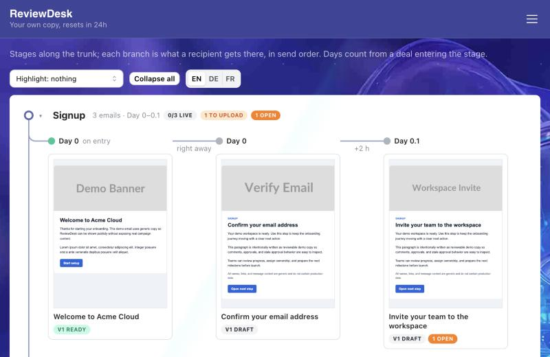
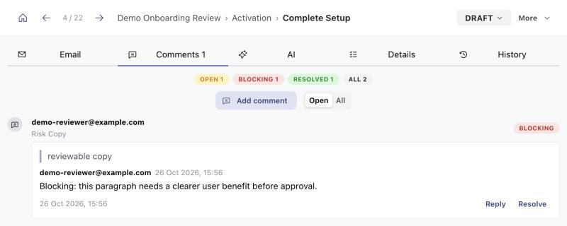

# ReviewDesk

A collaborative review and approval workspace for HTML email sequences and lifecycle journeys.

ReviewDesk is a focused review and approval layer for HTML email sequences before they are implemented in CRM, ESP, messaging, or other publishing systems. It keeps comments attached to reviewed content, makes approvals auditable, and helps teams hand off final approved assets without turning the product into a full email builder.

## Live Demo

**[demo.reviewdesk.rubashkin.xyz](https://demo.reviewdesk.rubashkin.xyz/)** — opens straight on a demo board, no sign-up. A short guide walks you through one review loop: open an email, fix a paragraph, resolve a blocking comment, mark it ready.

- Synthetic data only: a generic SaaS onboarding sequence (8 stages, 3 languages, 60 emails) with comments, approval states and handoff examples.
- Every visitor gets their own copy of the board that resets in 24 hours, so feel free to comment, edit and resolve.





## Why It Exists

ReviewDesk started as an internal tool for a partner onboarding team at a B2B SaaS company: an onboarding email chain in 5 languages, owned by several regional managers and implemented as CRM automation robots.

- **Before:** feedback lived in chats and screenshots, and changing a single email took about a week end to end.
- **After:** the whole 10-person team reviews, comments and edits in one place; the team rebuilt the entire chain (100+ localized emails) in one working week.
- **Rollout:** one pilot colleague → two → the whole team, with feature requests gathered from daily use. It runs in production and is part of onboarding for new hires.

This repository is a cleaned-up public copy without company content; its git history was squashed when it was extracted from the internal repo.

## Highlights

- Review board for staged HTML email sequences, language versions, and adaptations.
- Anchored comments on `data-review-block` content with severity and resolution state.
- Template-backed editing through `data-edit-*` fields while preserving original HTML.
- Required approval areas, stale approval behavior after edits, and production handoff state.
- CRM send reconciliation: a read-only sync pulls the emails CRM automation robots actually send, matches them to board emails by similarity, and suggests which approved version is live per robot.
- @mentions with notifications, and shared text blocks reused across emails.
- AI-assisted journey review for clarity, conversion friction, compliance risk, and handoff readiness.
- Go API, PostgreSQL, React, Mantine, TanStack Query, OTP/session auth, and SSE AI streaming.

## Stack

- Frontend: React 19, Vite, Mantine v9, TanStack Query, React Router.
- Backend: Go, Chi, pgx, direct SQL.
- Database: PostgreSQL with goose migrations.
- AI: shared cached analysis with first-run SSE/EventSource streaming.
- Auth: OTP login, session cookies, admin and super-admin roles.

## Local Setup

Prerequisites:

- Docker
- Go
- Node.js + npm
- `goose` on `PATH`

Commands:

```sh
cp .env.example .env
make setup-dev
make dev
```

Local walkthrough:

1. Sign in with the local dev login and open the `Demo Onboarding Review` board.
2. Add or resolve anchored comments in the review preview.
3. Edit template-backed copy or planning metadata as an admin.
4. Watch approvals go stale after content changes, then re-approve required areas.
5. Inspect the production handoff package.

Useful checks:

```sh
make lint
make test-api
make test-web
```

## Repo Layout

- `apps/api/cmd/server` - Go HTTP API.
- `apps/api/cmd/seed` - loader for your own templates in `db/seeds/emails` (not included).
- `apps/api/cmd/demoseed` - synthetic demo dataset (`db/seeds/demo-emails` plus generated emails).
- `apps/web/src` - React application.
- `db/migrations` - PostgreSQL migrations.
- `docs/` - [case study](docs/case-study.md), [backend](docs/Backend%20Architecture.md) and [frontend](docs/Frontend%20Architecture.md) architecture, [demo plan](docs/demo-plan.md), [roadmap](docs/roadmap.md).

## Demo Data

Generic public-demo data is seeded separately from normal team data:

```sh
DEMO_SEED_ENABLED=true make db-seed-demo
DEMO_SEED_ENABLED=true DEMO_RESET_CONFIRM=demo make db-reset-demo
```

See `docs/demo-plan.md` for the public demo strategy.

Public demo login is also environment-gated:

```env
AUTH_DEMO_LOGIN_ENABLED=true
VITE_AUTH_DEMO_LOGIN_ENABLED=true
```

## Notes

- Backend is the source of truth for review state, comments, approvals, versions, and handoff data.
- Original HTML is preserved; edited output is rendered from template-backed fields.
- Previewed third-party HTML is isolated in a sandboxed iframe.
- Comments use frontend polling; AI analysis uses SSE/EventSource, not WebSocket.
